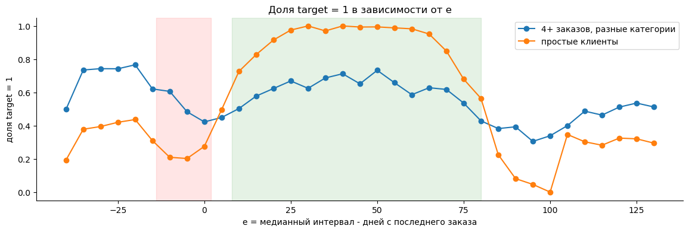

# Кто купит снова? Lamoda & ЦУ


Решение соревнования [«Кто купит снова? | Lamoda & ЦУ»](https://www.kaggle.com/competitions/lamoda-cu-repeat-purchase-2026) на Kaggle: по истории заказов клиента Lamoda нужно предсказать вероятность того, что он сделает покупку в течение 3 месяцев после даты скоринга.

**Итог: AP@20% = 0.750 на кросс-валидации по месяцам** (базовые признаки дают 0.647).

## Задача

- **Данные:** 1.2 млн товарных позиций (626 тыс. заказов) 100 тыс. клиентов за 2019-2022 годы и справочник из 565 тыс. товаров (категория, подкатегория, пол, бренд).
- **train:** 75 000 клиентов с датами скоринга 1 января, 1 февраля и 1 марта 2022 года, доля покупателей около 34%.
- **test:** 25 000 клиентов с датой скоринга 1 апреля 2022 года.
- **Особенность:** история каждого клиента обрезана за 14 дней до даты скоринга, последние две недели модель не видит.
- **Метрика:** AP@20% - средняя точность на первых 20% клиентов, отсортированных по скору. Важен только порядок клиентов, а не сами вероятности.

## Главная находка

Таргет в train оказался не настоящей повторной покупкой, а во многом построенным по правилу. Ожидаемая дата следующего заказа считается как **дата последнего заказа + медианный интервал между заказами клиента**:

- ожидаемый заказ попадает в окно прогноза - таргет почти всегда 1;
- ожидаемый заказ попадает в скрытые 14 дней перед датой скоринга или сразу после окна - таргет почти всегда 0.

Для «простых» клиентов (2-3 заказа или все покупки из одной категории) правило выполняется на 98-100%. У клиентов с 4+ заказами и разными категориями оно работает слабо.



По оси X отложено e = медианный интервал - дней с последнего заказа, то есть на сколько дней после даты скоринга приходится ожидаемый заказ. Зелёная зона - окно прогноза, красная - скрытые 14 дней.

Эта же находка объяснила, почему не сработало расширение обучающей выборки искусственными датами скоринга: история в данных настоящая, а таргет синтетический, и на псевдо-метках модель училась не той закономерности (AP@20% падал с 0.64 до 0.54).

## Результаты

Валидация - кросс-валидация по месяцам: каждый из трёх месяцев train по очереди уходит в валидацию, модель обучается на двух других.

| Признаки и модель | AP@20% |
|---|---|
| 35 базовых признаков (RFM, скидки, категории), LightGBM | 0.647 |
| + 6 главных признаков правила | 0.727 |
| + все 19 признаков правила | 0.743 |
| LightGBM после подбора Optuna | 0.750 |
| CatBoost после подбора Optuna | 0.749 |
| Смесь рангов LightGBM и CatBoost | **0.750** |

Главные признаки правила: число заказов, медианный интервал, e, расстояние от e до конца окна, число категорий и флаг «простого» клиента. Дополнительные: доли интервалов, указывающих в окно, e за последний год, отдельные e по каждой категории, покрытие главной категорией, номер зоны правила.

## Структура ноутбука

[mian.ipynb](mian.ipynb):

1. **EDA** - качество данных, распределения цен и скидок, заказы и клиенты, динамика по месяцам, окна истории, справочник товаров.
2. **Признаки** - 35 агрегатов на клиента: давность и частота, суммы, скидки и лояльность, активность за 30/90/180/365 дней, доли категорий и полов.
3. **Модели** - метрика AP@20% и сравнение LogisticRegression, RandomForest, LightGBM, XGBoost и CatBoost.
4. **Признаки ожидаемой даты следующего заказа** - разбор правила, 19 новых признаков и проверка на кросс-валидации.
5. **Подбор гиперпараметров** - Optuna для LightGBM и CatBoost и смесь лучших моделей.
6. **Сабмишен** - обучение на всём train и запись submission.csv.

## Как запустить

1. Скачать данные со [страницы соревнования](https://www.kaggle.com/competitions/lamoda-cu-repeat-purchase-2026/data) и положить в корень проекта: orders.parquet, products.parquet, train.csv, test.csv.
2. Установить зависимости:

   ```bash
   pip install -r requirements.txt
   ```

3. Запустить mian.ipynb сверху вниз. Подбор гиперпараметров в разделе 5 занимает около 25 минут на CPU, остальное считается за пару минут. В конце в папке появится submission.csv.

## Структура репозитория

```
├── mian.ipynb          ноутбук с полным решением
├── images/             графики для README
├── requirements.txt    зависимости
└── README.md
```

Данные соревнования в репозиторий не входят, их нужно скачать с Kaggle.
